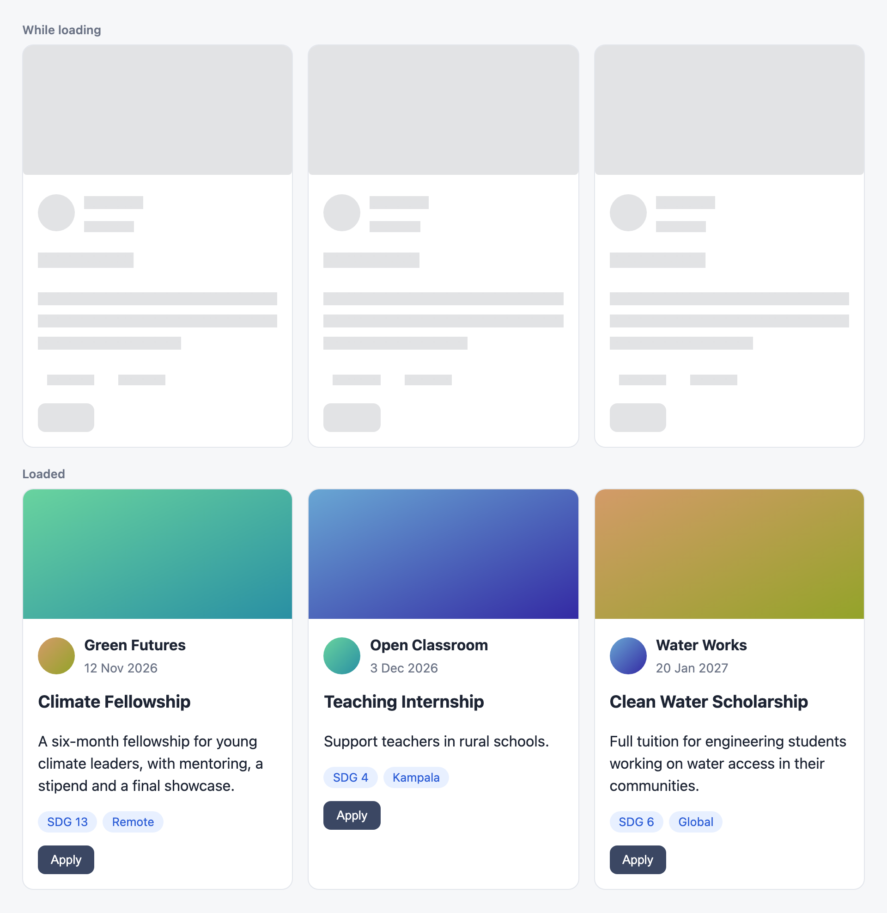

# skeletone

**CSS-only skeleton loaders from your real markup.** Add one attribute to a container and
everything inside it turns into a loading skeleton that matches the real layout. You don't
write separate skeleton components. The core is one stylesheet with no JavaScript, so it
works with any framework, and optional helpers for React, Vue and Svelte set the attributes
for you.

```html
<link rel="stylesheet" href="skeletone.css" />

<div data-skeleton inert>
  <article class="card">
    
    <h3></h3>
    <p data-skeleton-lines></p>
  </article>
</div>
```

About 1.6 KB gzipped. [Try the demo](https://sookwalinga.github.io/skeletone/demo/), or
[paste in your own markup](https://sookwalinga.github.io/skeletone/demo/playground.html).



## Why

Most skeleton loaders are a second, hand-written copy of each screen. When the real
component changes, the copy goes stale. skeletone has no copy to keep in step. While data
loads, your component renders as usual with empty values. The CSS then:

- turns each innermost element (images, icons, inputs) into a grey block,
- keeps each button's and link's own outline, greyed, with a bar for its label,
- draws text as one bar per line, as long as the line,
- gives empty text a text-height bar so it doesn't collapse,
- leaves every container, card, border, gap and grid untouched.

The skeleton is your layout, so it can't drift.

### Compared with

Other libraries also build the skeleton from the real UI. They do it with JavaScript or a
build step, where skeletone uses a stylesheet:

| Library                  | How the skeleton is made                              | What it needs                              |
| ------------------------ | ----------------------------------------------------- | ------------------------------------------ |
| skeletone                | CSS selectors over your markup                        | One attribute. No JavaScript               |
| [phantom-ui]             | A web component measures each element and overlays blocks | Client-side JavaScript, extra CSS to avoid a flash when server rendering |
| [boneyard-js]            | A CLI snapshots the page in a headless browser        | A build step, and snapshots to keep fresh  |
| [shimmer-from-structure] | A wrapper renders the component with mock props and measures it | Client-side JavaScript, an adapter per framework |
| [skeleton-ui-loader], [auto-skeleton-react] | A React component measures the rendered DOM | Client-side JavaScript, React only |
| [Skeleton Mammoth]       | CSS classes                                           | A class on every element, wrappers around images and inputs |

Measuring in JavaScript handles cases a stylesheet can't, such as shadow DOM (see
Limitations). skeletone suits you when you want no script, no build step
and a skeleton in the server-rendered HTML.

[phantom-ui]: https://github.com/Aejkatappaja/phantom-ui
[boneyard-js]: https://github.com/0xGF/boneyard
[shimmer-from-structure]: https://github.com/darula-hpp/shimmer-from-structure
[skeleton-ui-loader]: https://github.com/pavansharan007/skeleton-ui-loader
[auto-skeleton-react]: https://github.com/ShanukJ/auto-skeleton
[Skeleton Mammoth]: https://github.com/WOLFRIEND/skeleton-mammoth

## Install

```sh
npm install skeletone
```

```js
import 'skeletone/skeletone.css' // bundlers that handle CSS imports
```

Or use a `<link>` to `node_modules/skeletone/skeletone.css`, or skip the install and link to
a CDN copy:

```html
<link rel="stylesheet" href="https://cdn.jsdelivr.net/npm/skeletone@0.2/skeletone.css" />
```

The framework helpers are optional, and each is a separate import. A React app bundles only
`skeletone/react`, never the Vue or Svelte code. Installing skeletone doesn't install any
framework. Each helper ships as an ES module and as CommonJS, each with its own type
definitions, so Jest loads it without any transform config.

## Usage

Switch skeleton mode on with `data-skeleton`. Remove it, or set it to `"false"`, to show
the content.

Skeleton mode needs two attributes: `data-skeleton` draws the bars, and `inert` keeps focus,
clicks and screen readers out of the placeholder content (see Accessibility). The helpers
set both from one loading flag, and they render on the server too.

**React**

```jsx
import { skeleton, Skeleton } from 'skeletone/react'

<section {...skeleton(isLoading)}>
  <OpportunityCard opportunity={data ?? {}} />
</section>
```

`skeleton(loading)` returns both attributes, in the form your React version needs. Spread it
onto any element, or onto a component that passes props to its element, such as an MUI
`Box` or `Grid`. It adds no element of its own. Called with no argument, it's on.

`<Skeleton>` renders an element in skeleton mode, for when there's no element to spread
onto. `count` repeats the children while loading, so a list needs one placeholder record
instead of an array of them, and `label` tells screen readers what's loading:

```tsx
const LOADING_OPPORTUNITY = {} as Opportunity

<Skeleton label="Loading opportunities" count={6} loading={!data}>
  {data
    ? data.map((o) => <OpportunityCard key={o.id} opportunity={o} />)
    : <OpportunityCard opportunity={LOADING_OPPORTUNITY} />}
</Skeleton>
```

Its props, tables and lists, and components such as MUI's `TableBody` are covered in
[the React guide](docs/react.md).

**Vue**

```html
<script setup>
import { vSkeleton } from 'skeletone/vue'
</script>

<template>
  <span v-if="loading" role="status" class="skeletone-status">Loading articles</span>
  <section v-skeleton="loading">…</section>
</template>
```

Outside `<script setup>`, register it with `app.directive('skeleton', vSkeleton)`.
`v-skeleton` with no value is on. The span is the loading message for screen readers, which
React's `label` renders for you. Beside a table body, a row or a list item, wrap it as shown
in Accessibility.

**Svelte**

```svelte
<script>
  import { skeleton } from 'skeletone/svelte'
</script>

{#if loading}<span role="status" class="skeletone-status">Loading articles</span>{/if}
<section {...skeleton(loading)}>…</section>
```

The span is the loading message for screen readers, which React's `label` renders for you.
Beside a table body, a row or a list item, wrap it as shown in Accessibility.

**HTML and other frameworks**

```html
<section data-skeleton inert>…</section>
```

Remove both attributes to show the content. skeletone also treats `data-skeleton="false"`
as off. `inert` is a boolean attribute, so `inert="false"` still makes the element inert:
remove it, which most frameworks do when you pass `undefined`. In React 18 without the
helper, write `inert={isLoading ? '' : undefined}`.

Any framework that can set two attributes works the same way:

```html
<!-- Angular -->
<section [attr.data-skeleton]="loading ? '' : null" [attr.inert]="loading ? '' : null">…</section>

<!-- Solid -->
<section data-skeleton={loading() ? '' : undefined} attr:inert={loading() ? '' : undefined}>…</section>

<!-- Astro -->
<section data-skeleton={loading} inert={loading}>…</section>
```

### Paragraphs

An empty element has no way to say how much text it will hold, so you tell it. Mark it with
`data-skeleton-lines` (three lines), and set `--skeleton-lines` for another count:

```html
<p data-skeleton-lines></p>                              <!-- 3 lines -->
<p data-skeleton-lines class="bio"></p>                  <!-- .bio { --skeleton-lines: 6 } -->
```

The last line is drawn shorter so the block reads as a paragraph.

### Lists

A list mapped from no data renders as an empty `<ul>` or `<ol>`. skeletone draws it as three
rows, and `--skeleton-lines` sets another count. Nothing to configure, as long as the list
element itself renders without data:

```jsx
<ul className="steps">{steps?.map((s) => <li key={s.id}>{s.name}</li>)}</ul>  {/* 3 rows */}
```

The rows are drawn as lines of text, which suits a vertical list. A horizontal list of chips
looks better with a placeholder record (see the next section).

### Sections that need data to render

skeletone can only draw elements that are in the page. Keep wrappers outside your
conditions where you can, and when a section can't render without data, render it with a
placeholder record: the text is never shown, only its shape. `text(length)` from
`skeletone/text` makes placeholder words that wrap like real text, in any framework:

```jsx
import { text } from 'skeletone/text'

const placeholder = { title: text(40), about: text(320), tags: [text(5), text(5), text(5)] }

<main {...skeleton(isLoading)}>
  <Opportunity opportunity={data ?? placeholder} />
</main>
```

[The placeholder guide](docs/placeholders.md) covers empty values, TypeScript casts and
what a record has to hold.

### Keeping a section as it is

`data-skeleton-ignore` leaves an element and everything inside it untouched and clickable.
Use it for parts that don't depend on the data, such as a back link or a page header:

```html
<main data-skeleton>
  <header data-skeleton-ignore><a href="/">← All opportunities</a></header>
  <article inert>…</article>
</main>
```

Put `inert`, or the helper, on the loading part, not on the container. Everything inside an
inert element is inert, ignored sections included.

### Drawing an element as one bar

A coloured element that holds other elements keeps its colour, because only leaves become
bars: an avatar showing a fallback icon stays blue, a chip stays tinted around its label
bar. `data-skeleton-block` draws the element as one bar in the skeleton colour and hides
what's inside. It keeps its own size and corners, and does nothing outside skeleton mode. On
a button it replaces the greyed button and label bar with a plain block:

```jsx
<Avatar data-skeleton-block src={user.photo} />
<Chip data-skeleton-block label={`${count} permissions`} />
```

## Customise

All settings are CSS custom properties. Set them on the container, anywhere above it, or on
a section inside it to change just that section.

| Property                   | Default                                  | What it does                       |
| -------------------------- | ---------------------------------------- | ---------------------------------- |
| `--skeleton-color`         | 13% of the container's text colour       | Bar colour                         |
| `--skeleton-radius`        | `0.25em`                                 | Bar corners (an element's own radius wins) |
| `--skeleton-width`         | see the next two rows, else `100%`       | Bar width of empty text, on any element |
| `--skeleton-heading-width` | `40%`                                    | Bar width of an empty heading      |
| `--skeleton-inline-width`  | `4em`                                    | Width of empty inline text         |
| `--skeleton-last-line`     | `60%`                                    | Width of a paragraph's last line   |
| `--skeleton-lines`         | `3`                                      | Line count of a `data-skeleton-lines` element or an empty list |
| `--skeleton-animation`     | `skeletone-pulse`                        | Bar animation: `skeletone-shimmer` sweeps a band across the bars instead |

Bars take their colour from the container's text colour, so dark mode works without any
configuration. A dark or inverted section inside a light skeleton (or the other way round)
needs its own colour, since its bars would match its background:

```css
.dark-panel { --skeleton-color: rgb(255 255 255 / 0.13); }
```

Bars pulse by default. For a shimmer, set the animation once for the whole page:

```css
:root { --skeleton-animation: skeletone-shimmer; }
```

The pulse is animated by the browser's compositor. The shimmer is a moving mask, which
repaints every bar on every frame, so keep the pulse on pages with hundreds of bars.

## How it works

The whole library is one stylesheet. Inside `[data-skeleton]`:

1. Text is hidden with `-webkit-text-fill-color: transparent`, so it keeps its layout.
2. Leaf elements, meaning elements with no element children (`:not(:has(*))`), plus whole
   SVG icons, selects, videos and `data-skeleton-block` elements, get a background in the
   bar colour and a gentle pulse (or a shimmer). Checkboxes, radios, sliders, colour pickers, progress bars
   and meters draw their own look over any background, so they're greyed out instead, at
   their own size. A control's own parts are hidden: a file input's button and file name, a
   date or time picker's icon, a search field's clear button, a number field's arrows and
   a select's arrow.
   Buttons and links that hold only a label (text, an icon) keep their own background and
   border, greyed and faded the same way, and their label gets a bar. So a text button draws
   as text, an outlined one keeps its outline, and a link styled as a button looks like the
   button next to it. A link around block content, such as a whole card, is left to its
   contents.
   The bars show from the first frame, with the outlines around them, so a
   loader replaced by another one doesn't blink. The `[data-skeleton]` element counts too: one with no element children, such as
   `<p data-skeleton>12 users</p>`, is drawn like a leaf.
3. Text elements that hold text get a strike-through 0.6 of a line thick instead, so each
   wrapped line gets its own bar. A `<div>` that holds only text counts as a text element,
   and an empty one stays a block. Text blocks such as paragraphs, divs, list items and
   table cells keep their borders, so table rows keep their lines.
4. Empty elements get a `1lh` minimum height, and empty text elements a bar drawn as a
   gradient inside their padding, so they look like a line of text rather than a solid
   block. An element's own `min-height` wins, so a 44px button stays 44px. Icons, images,
   videos, canvases, iframes and form controls keep their own size.
5. `data-skeleton-lines` elements and empty lists get a height of `--skeleton-lines` lines,
   with the lines drawn as gradients.
6. The container ignores clicks and text selection, except inside `data-skeleton-ignore`.

## Accessibility

- Put `inert` on the container while it loads (the helpers do this for you). It removes
  the skeleton from the tab order and hides it from screen readers, so they don't read out
  placeholder text. CSS can do neither. `aria-busy` isn't needed on the same element: an
  inert element isn't announced.
- To announce loading, put a `role="status"` message outside the inert part. In React,
  `<Skeleton label="Loading articles">` renders one. Elsewhere, write it yourself and give
  it the `skeletone-status` class, which hides it on screen but not from screen readers.
  Render it only while loading:

  ```html
  <span role="status" class="skeletone-status">Loading articles</span>
  <section data-skeleton inert>…</section>
  ```

  Inside a table or a list, where a `<span>` isn't allowed, wrap it in a body, row or item
  with the `skeletone-status-group` class, which takes no space:

  ```html
  <tbody class="skeletone-status-group"><tr><td>
    <span role="status" class="skeletone-status">Loading roles</span>
  </td></tr></tbody>
  <tbody data-skeleton inert>…</tbody>
  ```
- The pulse and the shimmer stop when the user asks for reduced motion.
- In forced-colors mode (Windows high contrast), the skeleton keeps its own colours, so its
  text stays hidden, and draws its bars in the system's `GrayText`. `--skeleton-color`
  doesn't apply there.

## Browser support

Any browser with `:has()`, the `lh` unit and `color-mix()`: Chrome / Edge 111+, Safari
16.4+, Firefox 121+. Older browsers show the empty layout without bars.

Hiding a select's arrow, and a date or time picker's icon in Firefox, also needs relative
colours from `currentColor` (`rgb(from currentColor r g b)`), which the current version of
each browser has. An older version inside the baseline shows the arrow or icon over the bar.
Greying a button's or link's own colours needs them too. Without them a button keeps its
colours, with the label bar drawn over them.

## Limitations

- **Elements that render only when data exists** (`{data.tags && <Tags />}`) aren't in the
  page while loading, so they get no bars. Move the wrapper outside the condition, or render
  with a placeholder record (see Sections that need data to render). Adding elements takes JavaScript, so a
  stylesheet can't create them.
- **A button label in an inline-block element** (`<button><span style="display:inline-block">Save</span></button>`)
  gets no bar, because the button's bar doesn't reach inside inline blocks. Leave the label
  inline, or a flex item, which most component libraries do.
- **Text mixed with child elements** (`<p>By <a>Sam</a></p>`) is hidden, but only the child
  gets a bar. A stylesheet can't select the loose text, and a bar across the whole
  paragraph would be drawn twice over the child. Wrap the loose text in a `<span>`. Line
  breaks are fine: `<p>12 Main Street<br>Kampala</p>` gets a bar per line.
- **Whitespace-only elements** (`<p> </p>`, `<div class="avatar"> </div>`) aren't
  `:empty`, so they count as text and get no bar. Render them truly empty, or put
  `data-skeleton-block` on a shape.
- **Empty decorative elements** (a 1px divider `<div>`, an icon-font `<i>`) are leaves too,
  so they become bars at least a line tall. Mark them `data-skeleton-ignore`.
- **Real images and video posters** inside a skeleton are painted over. That's intended, but
  it includes logos.
- **Embedded frames** (`<iframe>`) show their content, which CSS outside the frame can't
  hide. Render them once the data has loaded. A `<canvas>` shows what was drawn on it, so
  draw once the data has loaded.
- **Backgrounds on containers and pseudo-elements** stay as they are: a hero's
  `background-image`, a custom checkbox drawn with `::before`. Only leaves become bars. Put
  `data-skeleton-block` on the element, or on the parent of one with a pseudo-element, to
  draw it as one bar.
- **Dark or inverted sections** get bars in the container's text colour, not their own, so
  on a dark panel in a light skeleton they don't show. Set `--skeleton-color` on the
  section (see Customise).
- **The shimmer sweeps each bar on its own**, starting from the bar's left edge, so bars
  that start at different points aren't in step. A strike-through bar takes only one
  colour, so the band is a mask, and unlike a background a mask can't be fixed to the
  viewport to line the bars up. It also clips anything drawn outside a bar's box.
- **Shadow DOM**: a stylesheet doesn't reach inside a web component's shadow root, so its
  contents stay as they are. Add skeletone.css to the shadow root and set `data-skeleton` on
  an element inside it.
- **A table message adds one `border-spacing` gap** to a table with separate borders (the
  browser default, 2px). Tables with `border-collapse: collapse`, as most styled tables
  have, don't move.

## Development

The sources are in `src/`. `yarn build` minifies them into the published files at the
root, and generates each helper's CommonJS copy from its ES module. The tests build first.

```sh
yarn install
yarn test          # Playwright: Chromium, Firefox, WebKit
yarn typecheck     # the helpers' type definitions
yarn build && open demo/index.html
```

`test/visual.spec.ts` compares the demo with stored screenshots, light and dark, in each
engine. Fonts differ between systems, so it runs only on Linux, in CI's Playwright
container, and is skipped elsewhere. After a deliberate visual change, run the
`screenshots` workflow and commit the images it uploads.

## License

MIT
